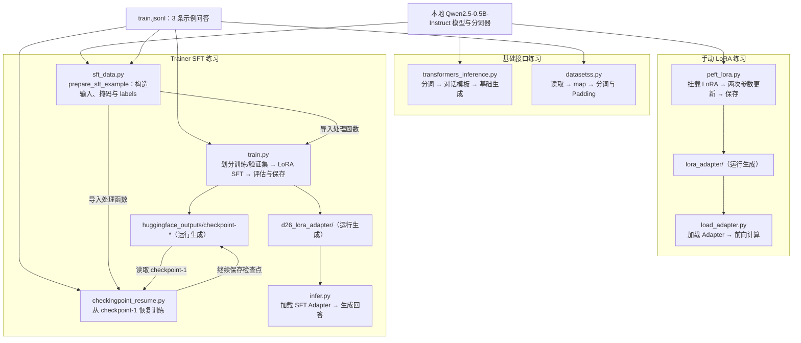

# Hugging Face 微调练习

记录学习 Hugging Face Transformers、Datasets 和 PEFT 时的 Python 练习，以 Qwen2.5-0.5B-Instruct 为例。

## 目录结构与文件作用

```text
hf-finetuning-practice/
├── transformers_inference.py  # 基础模型推理：分词、对话模板与文本生成
├── datasetss.py               # Dataset 入门：读取 JSONL、map、分词与 Padding
├── sft_data.py                # SFT 数据处理：仅监督回答，屏蔽提示词与 Padding
├── peft_lora.py               # LoRA 入门：挂载低秩参数、统计参数、手动更新并保存
├── load_adapter.py            # 重新加载 LoRA Adapter，做前向计算并查看 logits 形状
├── train.py                   # 使用 Trainer 做 LoRA SFT、评估并保存 Adapter
├── checkingpoint_resume.py    # 从 checkpoint-1 恢复 Trainer 训练
├── infer.py                   # 加载 SFT Adapter，通过对话模板生成回答
├── train.jsonl                # 3 条示例问答：机器学习、深度学习、Transformer
├── .gitignore                 # 仅放行源码、示例数据与说明，排除权重等产物
└── README.md                  # 项目说明与文件关系
```

## 文件关系图

以下箭头表示数据、函数或保存产物的流向；这些脚本分别练习不同环节，不是一个统一执行入口。



图中模型供各模型脚本加载，分词器供推理和数据处理脚本使用；Adapter 需要与基础模型一起加载。产物目录不随仓库上传。

## 使用说明

需要 Python、PyTorch、transformers、datasets、peft 和 accelerate，并提前准备模型本地缓存。依赖版本尚未整理为可复现环境。

仓库附带 `train.jsonl`，包含 3 条用于演示的问答文本，每行包含 `instruction` 和 `output` 两个字符串字段。模型、Adapter 权重和检查点不随仓库上传。

运行前请核对路径：基础推理脚本使用个人本地模型路径；`peft_lora.py` 将 Adapter 保存到当前工作目录，`load_adapter.py` 从脚本旁的 `lora_adapter` 加载；`infer.py` 需要 `train.py` 生成的 `d26_lora_adapter`；恢复训练需要 `huggingface_outputs/checkpoint-1`。建议从脚本所在目录运行。

`sft_data.py` 顶层包含演示代码，导入其函数时也会读取数据、加载分词器并打印中间结果。

这是学习过程中的源码记录，保留原练习写法。本次整理仅做源码审查与语法检查，未重新执行训练或验证模型效果。
